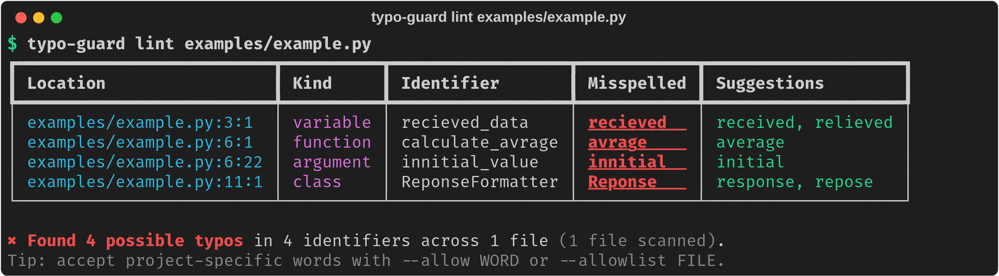
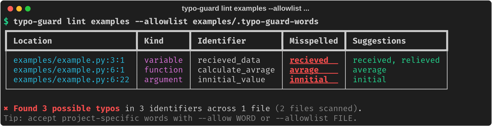
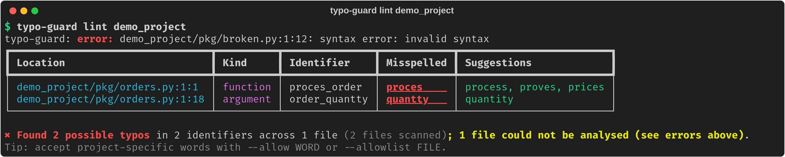
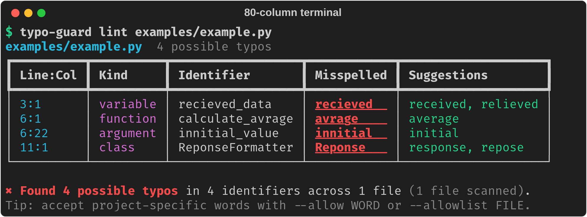
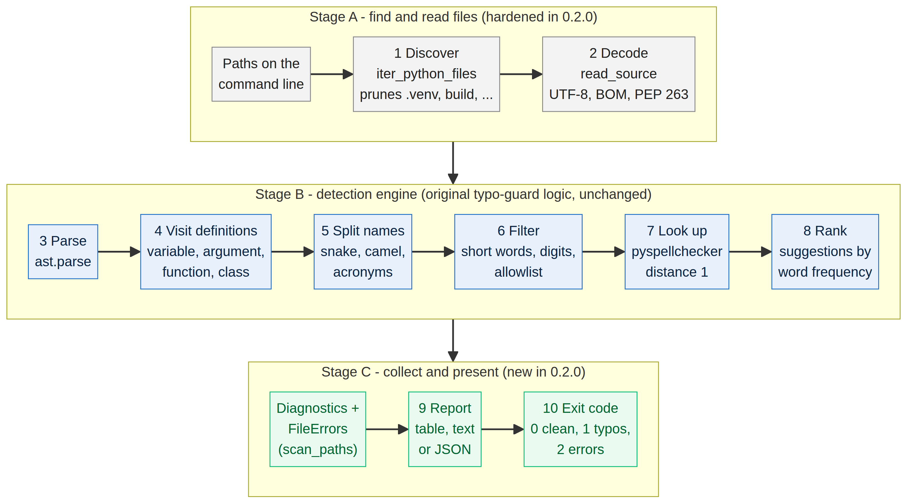

# typo-guard

**Catch spelling mistakes in Python names before they become part of your code base.**

`typo-guard` is a command-line linter and Python library that finds likely English
spelling mistakes in the names you define in Python code: variables, function
arguments, functions and classes. It reads code with Python's own parser (the
standard-library `ast` module), so strings, comments and docstrings are never
checked. It reports every finding in a clear, colour-coded table.



The same run as plain text (what you get in a CI log):

```text
$ typo-guard lint examples/example.py
┏━━━━━━━━━━━━━━━━━━━━━━━━━━┳━━━━━━━━━━┳━━━━━━━━━━━━━━━━━━┳━━━━━━━━━━━━┳━━━━━━━━━━━━━━━━━━━━┓
┃ Location                 ┃ Kind     ┃ Identifier       ┃ Misspelled ┃ Suggestions        ┃
┡━━━━━━━━━━━━━━━━━━━━━━━━━━╇━━━━━━━━━━╇━━━━━━━━━━━━━━━━━━╇━━━━━━━━━━━━╇━━━━━━━━━━━━━━━━━━━━┩
│ examples/example.py:3:1  │ variable │ recieved_data    │ recieved   │ received, relieved │
│ examples/example.py:6:1  │ function │ calculate_avrage │ avrage     │ average            │
│ examples/example.py:6:22 │ argument │ innitial_value   │ innitial   │ initial            │
│ examples/example.py:11:1 │ class    │ ReponseFormatter │ Reponse    │ response, repose   │
└──────────────────────────┴──────────┴──────────────────┴────────────┴────────────────────┘

✖ Found 4 possible typos in 4 identifiers across 1 file (1 file scanned).
Tip: accept project-specific words with --allow WORD or --allowlist FILE.
```

The complete instruction manual, covering installation, every option, how the program
works internally and what each test checks, is in **[docs/MANUAL.md](docs/MANUAL.md)**
(also available as a printable [PDF](docs/MANUAL.pdf)).

**Contents:**
[Motivation](#motivation) ·
[Innovation](#innovation) ·
[Installation](#installation) ·
[Usage](#usage) ·
[Reading the output](#reading-the-output) ·
[How it works](#how-it-works) ·
[Tests](#tests) ·
[Limitations](#known-limitations) ·
[Distribution](#distribution-and-publishing) ·
[Demo script](#one-minute-demo-script) ·
[Rubric](#assessment-rubric-checklist)

---

## Motivation

A misspelled name is still valid Python. `recieved_data = []` runs, the tests pass,
and the reviewer's eye slides over it. So identifier typos survive every normal
quality gate, and then they cause real costs:

- **They become API.** Once `calculate_avrage()` is public, fixing the spelling breaks every caller, so the typo tends to stay forever.
- **They break search.** Someone who searches the code for `received` will not find `recieved_data`, so bugs are fixed in one place and missed in another.
- **They spread.** Autocomplete copies the typo into every new line that uses the name, and the code ends up with two spellings of the same idea.
- **They slow readers down,** especially colleagues who read English as a second language and cannot tell whether `innitial` is a typo or a domain term.

General-purpose spellcheckers do not solve this well. A text spellchecker reads the
whole file, so it complains about URLs, SQL strings, test data and commented-out code,
and the useful warnings get lost in the noise. typo-guard checks only the names that
you define in the code, and it skips everything else.

## Innovation

typo-guard combines several ideas that existing tools do not offer together.

**1. It understands Python syntax.** typo-guard parses each file into an abstract
syntax tree with Python's own parser and reads only *definitions*: names that are
assigned, function and method names, argument names and class names. String
contents, comments, docstrings, attribute accesses such as `client.recieved_data`
and imported third-party names are ignored by construction, not by guesswork. This
is what keeps the report short and relevant.

**2. It splits names the way programmers write them.** `snake_case`, `camelCase`,
`PascalCase`, `UPPER_CASE` and acronyms are all split into words:
`HTTPResponseParsr` becomes `http` + `response` + `parsr`, and only `parsr` is
reported. Digits and underscores are separators, so `parseJSONPayload2` is checked
as `parse`, `json`, `payload`.

**3. It uses a full dictionary and ranks its suggestions.** Every word is looked up
in an offline English dictionary of about 160,000 words, using `pyspellchecker`.
Unknown words get suggestions that are one edit away (one letter inserted, deleted,
replaced or swapped). These are ranked by how common they are in English, so
`Reponse` suggests `response` before `repose`. No network access is needed and no
code leaves the machine.

**4. It explains each finding in a table.** Every row shows where the name is
(`file:line:column`, which most editors and terminals turn into a clickable link),
what kind of name it is, the full identifier, the misspelled part *as written in the
source*, and the suggestions. The layout adapts to the terminal width (see
[Reading the output](#reading-the-output)), and `--format text` / `--format json`
provide stable machine-readable output for scripts, editors and CI.

**5. It keeps going when a file is broken.** A syntax error, an undecodable file or an
unreadable file is reported for that file only. Every other file is still checked,
and the exit code tells CI exactly what happened.

**6. It learns your vocabulary.** Product names, abbreviations and domain terms can
be accepted with `--allow WORD` or a shared `--allowlist` file kept in the repository.

### How it compares

| Tool | What it reads | How it decides that a word is wrong | Consequence for Python identifiers |
|---|---|---|---|
| **typo-guard** | Only identifier definitions, taken from the Python AST | Missing from a full English dictionary; suggestions within one edit, ranked by frequency | Finds unknown misspellings such as `avrage` and ignores strings and comments. Domain words need an allowlist. |
| [codespell](https://github.com/codespell-project/codespell) | Any text file, line by line | Matches a list of *known common misspellings* | Very few false alarms, but its README notes it "will not catch" a misspelling that is not in the list. It also reports words inside strings and comments. |
| [typos](https://github.com/crate-ci/typos) | Any text file, splitting identifiers | Matches a curated list of known typo corrections | Fast and quiet, but it is language-agnostic: it does not know which words are Python names and which are inside strings or comments. |
| [pylint spelling checker](https://pylint.readthedocs.io/en/latest/user_guide/checkers/features.html) | Comments and docstrings | Dictionary via `pyenchant` | Its messages are `wrong-spelling-in-comment` and `wrong-spelling-in-docstring`; identifiers are not covered. |

typo-guard is meant to be used *alongside* these tools: codespell or typos for prose and
comments, and typo-guard for the names in the code.

## Installation

### Requirements

You need Python 3.9 or newer (tested on 3.9, 3.10, 3.11, 3.12, 3.13 and 3.14) and `pip`.
Two small dependencies are installed automatically: `pyspellchecker` provides the
offline dictionary and `rich` draws the table. typo-guard needs no internet
connection after installation.

### Option A: install from PyPI

Once the package is published:

```bash
python -m pip install typo-guard
```

### Option B: install from the source folder (recommended for review and development)

1. Open a terminal in the project folder (the one that contains `pyproject.toml`).
2. Create and activate a virtual environment.

   macOS / Linux:
   ```bash
   python3 -m venv .venv
   source .venv/bin/activate
   ```

   Windows (PowerShell):
   ```powershell
   py -m venv .venv
   .venv\Scripts\Activate.ps1
   ```

3. Install the package in editable mode together with the test tools:

   ```bash
   python -m pip install --upgrade pip
   python -m pip install -e ".[dev]"
   ```

### Option C: install from a wheel file (offline machines)

```bash
python -m pip install build
python -m build                      # creates dist/typo_guard-0.2.0-py3-none-any.whl
python -m pip install dist/typo_guard-0.2.0-py3-none-any.whl
```

### Check the installation

```bash
typo-guard --version
# typo-guard 0.2.0
```

If your shell says `typo-guard: command not found`, the scripts folder of your Python
installation is not on your `PATH`. Activate the virtual environment, or run the same
program as a module: `python -m typo_guard --version`.

## Usage

### Quick start

```bash
typo-guard lint examples/example.py                                    # 4 findings, exit code 1
typo-guard lint examples/clean_example.py                              # no findings, exit code 0
typo-guard lint examples/example.py examples/clean_example.py --allowlist examples/.typo-guard-words  # 'Reponse' accepted
```

### Everyday commands

| Goal | Command |
|---|---|
| Check one file | `typo-guard lint app.py` |
| Check a whole project (recursively) | `typo-guard lint .` |
| Check several paths | `typo-guard lint src tests scripts/deploy.py` |
| Accept a few words | `typo-guard lint src --allow numpy --allow k8s,grpc` |
| Accept the words listed in a file | `typo-guard lint src --allowlist .typo-guard-words` |
| Use British English spelling | `typo-guard lint src --language en-GB` |
| Add words from a dictionary file | `typo-guard lint src --dictionary project-words.txt` |
| Skip generated code | `typo-guard lint . --exclude migrations --exclude "*_pb2.py"` |
| One line per finding (scripts, editors) | `typo-guard lint src --format text` |
| JSON for other tools | `typo-guard lint src --format json > typos.json` |
| Only the best suggestion | `typo-guard lint src --max-suggestions 1` |
| Report without failing the build | `typo-guard lint src --exit-zero` |
| Plain output without colours | `typo-guard lint src --no-color` (or set `NO_COLOR=1`) |
| Run without the console script | `python -m typo_guard lint src` |

Run `typo-guard lint --help` for the full option list; every option is explained in
the [manual](docs/MANUAL.md#5-command-reference).

### Example: text format

```text
$ typo-guard lint examples/example.py --format text
examples/example.py:3:1: TG001 possible typo 'recieved' in variable 'recieved_data' (suggestions: received, relieved)
examples/example.py:6:1: TG001 possible typo 'avrage' in function 'calculate_avrage' (suggestions: average)
examples/example.py:6:22: TG001 possible typo 'innitial' in argument 'innitial_value' (suggestions: initial)
examples/example.py:11:1: TG001 possible typo 'reponse' in class 'ReponseFormatter' (suggestions: response, repose)
Found 4 possible typo(s).
```

### Example: JSON format

```text
$ typo-guard lint examples/example.py --format json
[
  {
    "path": "examples/example.py",
    "line": 3,
    "column": 1,
    "kind": "variable",
    "identifier": "recieved_data",
    "word": "recieved",
    "suggestions": [
      "received",
      "relieved"
    ]
  },
  ...
]
```

### Example: a project vocabulary

Words that are correct in your project but not in an English dictionary go into a text
file. You can put one or more words on each line, and text after `#` is a comment:

```text
# .typo-guard-words
reponse            # internal product name
k8s grpc protobuf  # several words on one line
```



### Example: British English and an extra dictionary

The default is American English. Use `--language en-GB` to accept common British
spellings such as `colour`, `organise`, `centre` and `travelling`. A supplemental
dictionary file adds project or regional words to either language without replacing
the built-in English dictionary:

```text
# project-words.txt (UTF-8)
colourway
organisation, programme
```

```bash
typo-guard lint src --language en-GB --dictionary project-words.txt
```

Dictionary files accept words separated by spaces, commas or new lines; text after
`#` is treated as a comment. Use `--allowlist` for a team's accepted vocabulary, or
`--dictionary` when maintaining a reusable supplemental word list.

### Example: one broken file does not stop the run



The virtual environment inside `demo_project/.venv` was skipped automatically, the
syntax error was reported with its exact position, and the typos in the other file
were still found. The exit code is 2 because one file could not be analysed.

### Use in continuous integration

GitHub Actions:

```yaml
- run: python -m pip install typo-guard
- run: typo-guard lint src tests --allowlist .typo-guard-words
```

[pre-commit](https://pre-commit.com) (`.pre-commit-config.yaml` in your project):

```yaml
repos:
  - repo: https://github.com/your-org/typo-guard
    rev: v0.2.0
    hooks:
      - id: typo-guard
        args: [--allowlist, .typo-guard-words]
```

### Use from Python

```python
from typo_guard import lint_source, scan_paths

for issue in lint_source("def calculate_avrage(innitial_value): ...", filename="demo.py"):
    print(issue.location, issue.kind, issue.word, issue.suggestions)
# demo.py:1:1 function avrage ('average',)
# demo.py:1:22 argument innitial ('initial',)

result = scan_paths(["examples"])            # never raises for a bad file
print(len(result.files), "files,", len(result.diagnostics), "typos,", len(result.errors), "errors")
# 2 files, 4 typos, 0 errors
```

## Reading the output

| Column | Meaning |
|---|---|
| **Location** | `path:line:column` of the definition, counted from 1. For functions and classes the column points at the `def` / `class` keyword (where Python's parser places the definition); for variables and arguments it points at the name itself. |
| **Kind** | `variable` (assignment, `for`, `with ... as`, comprehension, `:=`, `del` targets), `argument` (any function parameter, including `*args` and `**kwargs`), `function` (`def`, `async def`, methods) or `class`. |
| **Identifier** | The complete name, so you can search the code for it. |
| **Misspelled** | The unknown word, exactly as written inside the name (`Reponse` in `ReponseFormatter`). |
| **Suggestions** | Up to three dictionary words one edit away, most common first. `(none)` means the word is unknown and nothing similar exists. This is often a domain term to allowlist. |

The layout adapts to the space available. If the full table fits, you get the table
shown at the top. On a classic 80-column terminal, typo-guard prints one table per file
with the path as a heading, so nothing needs to wrap. On very narrow terminals each
finding takes two lines. Output that is piped or redirected (`> report.txt`, CI logs)
always gets the full table and is never cropped.



| Exit code | Meaning |
|---:|---|
| `0` | No possible typos found (or `--exit-zero` was given). |
| `1` | One or more possible typos found. |
| `2` | A path does not exist, the allowlist cannot be read, the command line is invalid, or at least one file could not be read or parsed. Typos in the other files are still reported. |
| `130` | Interrupted with Ctrl+C. |

## How it works



1. **Find files.** Each path is expanded into `.py` files. Directories are walked recursively and in sorted order, symbolic links are not followed, and tool folders such as `.venv`, `__pycache__`, `build` or `node_modules` are skipped.
2. **Read files** the way the Python interpreter does: UTF-8 by default, a byte-order mark is accepted, and an encoding declared with `# -*- coding: ... -*-` is respected.
3. **Parse** the text with `ast.parse`. Comments disappear at this step, and strings become literal values that are never inspected.
4. **Collect definitions** with an AST visitor: assignment targets, function and method names, every kind of parameter, and class names. Names starting with `__` (such as `__init__`) are skipped.
5. **Split each name into words** at underscores, digits, lower-to-upper case changes and acronym boundaries.
6. **Filter** out words shorter than three letters, allowlisted words (built-in programming vocabulary, Python keywords, built-in function names, and your own words).
7. **Look up** each remaining word in the offline dictionary. An unknown word becomes a finding, with suggestions one edit away ranked by English word frequency.
8. **Report** the findings as a table, text or JSON, then exit with 0, 1 or 2.

Steps 3 to 7 are the original typo-guard detection engine, which version 0.2.0 keeps
unchanged. A test checks this against a copy of the 0.1.0 code. Version 0.2.0
hardened steps 1, 2 and 8 and added the table. The [manual](docs/MANUAL.md#6-under-the-hood)
walks through every step with examples.

## Tests

```bash
python -m pip install -e ".[dev]"
python -m pytest            # 170 tests, about 10 seconds
python -m pytest -v         # list every test by name
```

| Test file | Tests | What it proves |
|---|---:|---|
| `tests/test_core.py` | 11 | Splitting, AST extraction, ignored strings/comments/attributes, allowlists, recursion, British spelling variants and supplemental dictionary words. |
| `tests/test_engine_preserved.py` | 42 | The 0.2.0 engine is structurally identical to the 0.1.0 code and produces identical findings on a corpus. |
| `tests/test_examples.py` | 25 | The demo files give exactly the rows shown above, and the ten acceptance cases from the original README are automated. |
| `tests/test_cli.py` | 24 | Command-line options, including British English and supplemental dictionary files, the three output formats and every exit code. |
| `tests/test_report.py` | 21 | Table columns, styles, colours, the three width layouts, ASCII fallback and summary wording. |
| `tests/test_hardening.py` | 40 | One regression test for every robustness defect fixed in 0.2.0 (encodings, broken files, virtual environments, broken pipes, ...). |
| `tests/test_packaging.py` | 7 | Version, entry point, dependencies, typing marker and pre-commit hook are consistent, and typo-guard lints its own code cleanly. |

The [manual](docs/MANUAL.md#7-the-test-suite) explains what each group of tests
represents and how to run a single test.

## Known limitations

- **Dictionary-based checking produces some false positives.** Names of people and products, abbreviations and technical jargon may not be in the built-in English dictionary. Add them with `--dictionary FILE` or the project's allowlist.
- **English only.** American English is the default. `--language en-GB` accepts common British spelling variants, while `--dictionary FILE` adds extra words. The British variant covers common spelling patterns and equivalents rather than providing a separate, exhaustive British dictionary.
- **Results depend on the dictionary version.** `pyspellchecker` 0.8.4 and newer know 160,572 words; the oldest supported version, 0.8.1, knows 138,581. Pin the version in CI if every machine must give identical results.
- **Definitions only.** Attribute names (`self.recieved = ...`), imported names, keyword arguments at call sites, `lambda` parameters, `except ... as name` and `match` captures are not checked. A typo is reported where the name is *defined*, not at every use.
- **Words shorter than three letters are skipped,** so very short abbreviations are never reported.
- **It reports, it does not rewrite.** Renaming should be done with your editor's rename refactoring so that every use is updated.

## Project layout

```text
typo-guard/
├── pyproject.toml              package metadata, dependencies, console script, pytest settings
├── README.md                   this overview
├── CHANGELOG.md                what changed in 0.2.0 and what was preserved
├── LICENSE                     MIT
├── .pre-commit-hooks.yaml      lets other projects use typo-guard as a pre-commit hook
├── .typo-guard-words           typo-guard's own vocabulary (it lints itself in CI)
├── .github/workflows/tests.yml CI: Python 3.9-3.14 on Linux, plus Windows and macOS
├── docs/
│   ├── MANUAL.md               the full instruction manual
│   ├── MANUAL.pdf              the same manual as a printable PDF
│   └── images/                 screenshots and the pipeline diagram
├── examples/
│   ├── example.py              demo file with four intentional typos
│   ├── clean_example.py        correctly spelled file (typos only in strings/comments)
│   └── .typo-guard-words       demo allowlist
├── src/typo_guard/
│   ├── core.py                 detection engine: AST visitor, splitter, dictionary lookup
│   ├── dictionary.py           British-English view and supplemental vocabulary
│   ├── runner.py               fault-tolerant multi-file scan (findings + per-file errors)
│   ├── report.py               table, text and JSON output
│   ├── cli.py                  command-line interface and exit codes
│   ├── __init__.py             public API and version
│   ├── __main__.py             enables `python -m typo_guard`
│   └── py.typed                marks the package as typed
└── tests/                      170 tests (see above) and the 0.1.0 reference engine
```

## Distribution and publishing

**Share the source.** Zip the folder (without `.venv`) or push it to a Git host. The
recipient follows [Option B](#option-b-install-from-the-source-folder-recommended-for-review-and-development).

**Share a wheel.** Run `python -m build` and send `dist/typo_guard-0.2.0-py3-none-any.whl`.
It installs offline with `pip install <file>`, provided the two dependencies are
available.

**Install straight from Git.** Use
`python -m pip install "git+https://github.com/your-org/typo-guard.git@v0.2.0"`.

**Publish to PyPI:**

1. Replace every `your-org` URL in `pyproject.toml`, this README and `CHANGELOG.md` with the real repository URL.
2. PyPI cannot display relative image paths. Before uploading, change the image links in this README to absolute `https://raw.githubusercontent.com/<org>/typo-guard/main/docs/images/...` URLs.
3. Check that the name is still free at https://pypi.org/project/typo-guard/ (it was unregistered on 2026-11-04).
4. Build, check, and upload, trying TestPyPI first:

   ```bash
   python -m build
   python -m twine check dist/*
   python -m twine upload --repository testpypi dist/*
   python -m twine upload dist/*
   ```

5. Tag the release (`git tag v0.2.0 && git push --tags`) so the pre-commit hook can pin it.

Never commit a PyPI token; use `TWINE_PASSWORD`, a keyring or PyPI trusted publishing.

## Assessment rubric checklist

| Criterion | Where it is satisfied |
|---|---|
| **Motivation** | [Motivation](#motivation): why identifier typos matter and why plain spellcheckers are not enough. |
| **Innovation** | [Innovation](#innovation) and [How it compares](#how-it-compares): six distinguishing ideas and a comparison with codespell, typos and pylint. |
| **Installation guide** | [Installation](#installation): three installation routes, per-OS commands and verification. The manual adds troubleshooting. |
| **Usage examples** | [Usage](#usage): quick start, a command table, real outputs in all three formats, allowlist, CI, pre-commit and Python API. |
| **Functional** | 170 collected pytest cases on Python 3.9 to 3.14, a fault-tolerant runner, and documented exit codes. |
| **Documented** | This README, the [manual](docs/MANUAL.md) (install, internals, tests, troubleshooting) and the [changelog](CHANGELOG.md). |
| **Published** | `pyproject.toml` is ready, `twine check` passes, and the steps are in [Distribution and publishing](#distribution-and-publishing). |
| **Teamwork** | Use a public Git repository with regular, meaningful commits from every group member. |

## License

MIT. See [LICENSE](LICENSE).
