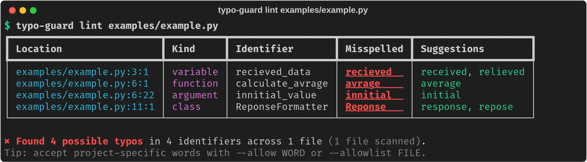
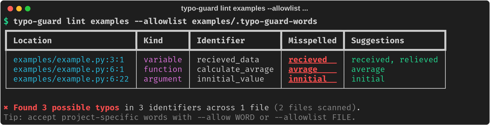
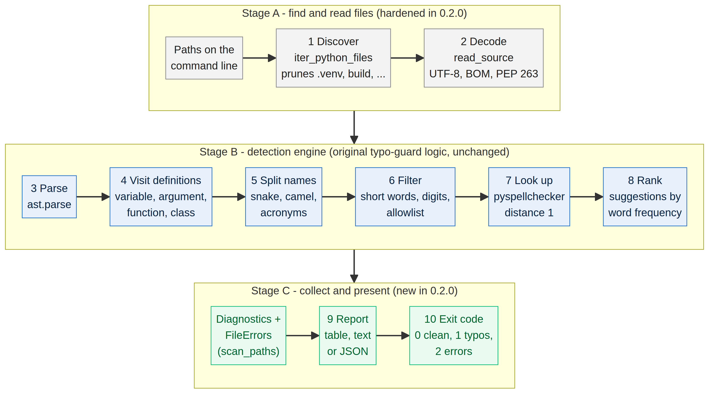
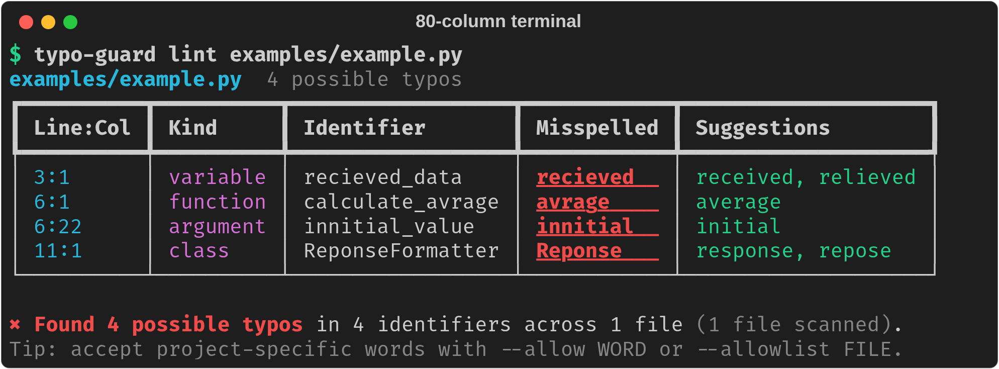
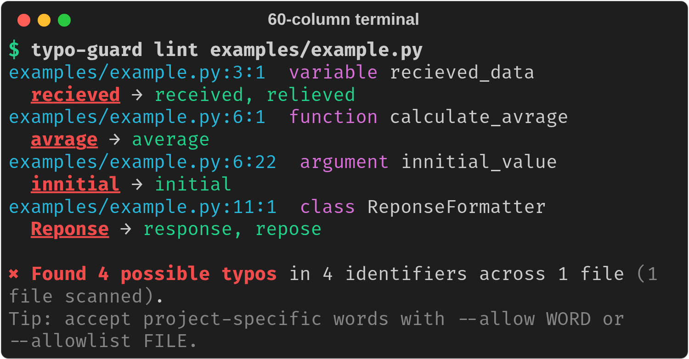

# typo-guard Instruction Manual

Version 0.2.0

This manual explains how to install typo-guard, how to use it day to day, what the
program does internally, and what the automated tests check. It is written for two
readers: someone who wants to *use* the tool, and someone who wants to *understand or
review* it. The first group can stop after section 5. The second group should read
sections 6 and 7.

**Contents**

1. [What typo-guard does](#1-what-typo-guard-does)
2. [Installation, step by step](#2-installation-step-by-step)
3. [Your first run: a guided tour](#3-your-first-run-a-guided-tour)
4. [Everyday use](#4-everyday-use)
5. [Command reference](#5-command-reference)
6. [Under the hood](#6-under-the-hood)
7. [The test suite](#7-the-test-suite)
8. [Troubleshooting and FAQ](#8-troubleshooting-and-faq)
9. [Glossary](#9-glossary)

---

## 1. What typo-guard does

typo-guard looks for spelling mistakes in the **names you define in Python code**.
These names are called *identifiers*: variable names, function and method names,
argument names and class names. For every name it finds, it splits the name into
English words, checks each word against an offline dictionary, and reports the words
it does not recognise, together with suggested corrections.

Three properties make typo-guard different from a normal spellchecker.

- **It only reads definitions.** It understands Python syntax, so text inside strings, comments and docstrings is never checked. Uses of a name, attribute names such as `self.value` and names imported from other packages are not checked either. A typo is reported once, where the name is created.
- **It knows how programmers write names.** `recieved_data`, `setInnitialValue`, `ReponseFormatter` and `HTTPResponseParsr` are all split correctly into words before they are checked.
- **It is made for automation.** Results come as a readable table, as one line per finding, or as JSON, and the exit code tells a CI pipeline whether typos were found.

A **finding** is one unknown word inside one identifier. An identifier such as
`recieved_innitial_data` produces two findings, one for `recieved` and one for
`innitial`.

## 2. Installation, step by step

### 2.1 Check that Python is available

typo-guard needs **Python 3.9 or newer**. Open a terminal (macOS: *Terminal*; Windows:
*PowerShell* or *Windows Terminal*; Linux: any terminal) and run:

```bash
python3 --version        # macOS / Linux
py --version             # Windows
```

If the version shown is lower than 3.9, or the command is not found, install a
current Python from <https://www.python.org/downloads/> first. On Windows, tick
"Add python.exe to PATH" in the installer.

### 2.2 Get the project

If you received the project as a ZIP file, unzip it. If it is in a Git repository,
clone it. Then move into the folder that contains `pyproject.toml`:

```bash
cd typo-guard
```

### 2.3 Create a virtual environment

A virtual environment keeps typo-guard and its two dependencies separate from the
rest of your system. You create it once, then activate it in every new terminal.

macOS / Linux:

```bash
python3 -m venv .venv
source .venv/bin/activate
```

Windows PowerShell:

```powershell
py -m venv .venv
.venv\Scripts\Activate.ps1
```

Windows Command Prompt (`cmd.exe`):

```bat
py -m venv .venv
.venv\Scripts\activate.bat
```

After activation the prompt starts with `(.venv)`. If PowerShell refuses to run the
activation script, run `Set-ExecutionPolicy -Scope CurrentUser RemoteSigned` once and
try again.

### 2.4 Install typo-guard

For normal use:

```bash
python -m pip install --upgrade pip
python -m pip install .
```

For development, reviewing or running the tests, install in *editable* mode with the
test tools. Code changes then take effect without reinstalling:

```bash
python -m pip install -e ".[dev]"
```

This installs the two runtime dependencies automatically. `pyspellchecker` (0.8.1 or
newer) contains the English dictionary, and `rich` (12.0 or newer) draws the table.
Nothing is downloaded when typo-guard runs.

Other installation routes are described in the README: from PyPI once published
(`python -m pip install typo-guard`), from a wheel file for offline machines, and
directly from a Git URL.

### 2.5 Verify the installation

```bash
typo-guard --version
```

The expected output is `typo-guard 0.2.0`. Then run the demo:

```bash
typo-guard lint examples/example.py
```

You should see a table with four findings (section 3 explains it).

### 2.6 Upgrade or uninstall

```bash
python -m pip install --upgrade typo-guard     # or: python -m pip install -e . again
python -m pip uninstall typo-guard
```

To remove everything, delete the `.venv` folder.

## 3. Your first run: a guided tour

### 3.1 The demo file

`examples/example.py` is a short, valid Python file with four intentional typos:

```text
 1  """Small demonstration file containing intentional identifier typos."""
 2
 3  recieved_data = [10, 20, 30]
 4
 5
 6  def calculate_avrage(innitial_value: int) -> float:
 7      total_value = sum(recieved_data) + innitial_value
 8      return total_value / len(recieved_data)
 9
10
11  class ReponseFormatter:
12      pass
```

Python runs this file without complaint, which is exactly the problem typo-guard
solves.

### 3.2 Run typo-guard

```bash
typo-guard lint examples/example.py
```



### 3.3 Read the table row by row

**Row 1: `examples/example.py:3:1`, variable `recieved_data`.** Line 3 assigns a
value to `recieved_data`, so it is a *variable definition*. The name is split into
`recieved` and `data`. `data` is a dictionary word; `recieved` is not. The dictionary
words one edit away are `received` (the `i` and `e` swapped) and `relieved` (one
letter replaced). `received` is listed first because it is more common in English.

Lines 7 and 8 also mention `recieved_data`, but only to *read* it. typo-guard reports
a name where it is defined, not at every use, so these lines produce no extra rows.

**Row 2: `6:1`, function `calculate_avrage`.** A `def` statement defines a function.
The location points at column 1, where the `def` keyword starts, because that is
where Python's parser records the definition. Only `avrage` is unknown, and the
suggestion is `average`.

**Row 3: `6:22`, argument `innitial_value`.** Function parameters are reported as
*arguments*, at the column where the parameter name begins. `innitial` becomes
`initial` by deleting one `n`.

**Row 4: `11:1`, class `ReponseFormatter`.** The PascalCase name is split into
`Reponse` and `Formatter`. The Misspelled column shows the word exactly as it appears
in the source (`Reponse`, with a capital R) so you can find it quickly. Two words are
one edit away: `response` and `repose`.

`total_value` on line 7 is also a definition, but both of its words are spelled
correctly, so it is not reported.

Under the table, the summary line counts the findings, the affected identifiers, the
affected files and the scanned files. The exit code of this run is `1` ("typos
found"); check it with `echo $?` (macOS/Linux) or `$LASTEXITCODE` (PowerShell).

### 3.4 Strings and comments are never checked

`examples/clean_example.py` contains the same misspellings, but only inside a
comment and a string:

```python
def calculate_average(initial_value: int) -> float:
    # Comments may contain anything, e.g. "recieved" or "avrage".
    message = "strings are ignored too: innitial, reponse"
```

```bash
typo-guard lint examples/clean_example.py
```


Nothing is reported and the exit code is `0`. A plain-text spellchecker would report
four words here.

### 3.5 Accept a word on purpose

Suppose `Reponse` is the real name of an internal product. The file
`examples/.typo-guard-words` lists it as an accepted word:

```text
reponse   # pretend this is an internal product name
```

```bash
typo-guard lint examples/example.py examples/clean_example.py --allowlist examples/.typo-guard-words
```



This time the two demo files were scanned and the class name is no longer reported.
This is the normal way to handle domain vocabulary.

## 4. Everyday use

### 4.1 Checking a project

Pass any mix of files and folders. Folders are searched recursively for `.py` files,
in sorted order, and each file is checked once even if it is reached twice:

```bash
typo-guard lint .
typo-guard lint src tests tools/release.py
```

While searching folders, typo-guard skips the folders that hold other people's code or
generated files: `.venv`, `venv`, `.git`, `.hg`, `.svn`, `__pycache__`, `.tox`,
`.nox`, `.mypy_cache`, `.pytest_cache`, `.ruff_cache`, `.eggs`, `*.egg-info`, `build`,
`dist`, `_build`, `buck-out`, `node_modules`, `site-packages`, `__pypackages__`,
`.direnv`, `.ipynb_checkpoints` and `.bzr`. A path you name explicitly is always
scanned, even inside one of these folders (`typo-guard lint build/generated.py`).

To skip more, add `--exclude` with a folder or file name pattern. The pattern is
compared with each name, not with the whole path, and `*` and `?` work as wildcards:

```bash
typo-guard lint . --exclude migrations --exclude "*_pb2.py"
```

If a path given on the command line is a file that does not end in `.py`, typo-guard
prints a warning and skips it. If a path does not exist, it stops with exit code 2
before scanning anything, so that a typo in a CI script is noticed.

### 4.2 Managing your project's vocabulary

Every real project uses words that are not in an English dictionary: product names,
abbreviations (`k8s`), library names (`grpc`), and jargon. Use an inline word or a
committed word list for project-specific vocabulary; a supplemental dictionary file
can also be shared across projects.

The `--allow` option is useful for a quick test. It can be repeated and accepts
comma-separated lists:

```bash
typo-guard lint src --allow grpc --allow k8s,protobuf
```

An **allowlist file** is the better choice for a team, because it is committed to the
repository and reviewed like code. The format is plain UTF-8 text. Words can be
separated by spaces, commas or new lines, everything after `#` is a comment, blank
lines are ignored, and case does not matter:

```text
# .typo-guard-words - accepted vocabulary for this project
grpc protobuf k8s          # infrastructure
acme                       # our company name
```

```bash
typo-guard lint src --allowlist .typo-guard-words --allow tempword
```

Both can be used together. typo-guard already accepts about sixty common programming
words (`args`, `kwargs`, `config`, `json`, `utf`, `uuid`, ...), every Python keyword
and every built-in name (`isinstance`, `enumerate`, ...), so you do not need to list
those.

For a reusable supplemental word list, use `--dictionary FILE`. It accepts the same
UTF-8 format as the allowlist, including comma- or space-separated words and `#`
comments. Unlike `--allowlist`, which is intended for project vocabulary, this option
is a separate dictionary file that can be shared between projects:

```text
# project-words.txt
colourway
protobuf, grpc
```

```bash
typo-guard lint src --dictionary project-words.txt
```

American English is the default. Select `--language en-GB` to accept common British
spellings such as `colour`, `organise`, `centre` and `travelling`. This is a
British-spelling compatibility layer over the bundled American-English dictionary,
not a separate exhaustive British dictionary. Add less common regional words with
`--dictionary` or `--allowlist`.

**When to rename instead of allowlisting:** allowlist a word when it is *correct for
your project*. If the word is simply misspelled, rename the identifier with your
editor's rename refactoring, so that every use is updated as well.

typo-guard itself follows this practice. Its repository contains a
`.typo-guard-words` file with 28 technical words such as `filename`, `subparsers` and
`monkeypatch`, and CI runs `typo-guard lint src tests --allowlist .typo-guard-words`
on every push.

### 4.3 Choosing an output format

| Format | Option | Best for |
|---|---|---|
| Table | (default) | People reading results in a terminal or a CI log. |
| Text | `--format text` | Editors and `grep`; one `path:line:col: TG001 ...` line per finding. This is identical to typo-guard 0.1.0. |
| JSON | `--format json` | Other programs, dashboards, custom reports. A list of objects with `path`, `line`, `column`, `kind`, `identifier`, `word` and `suggestions`. |

Error and warning messages always go to *standard error*, so the standard output of
`--format json` is always valid JSON and can be redirected safely:

```bash
typo-guard lint src --format json > typos.json
```

`--max-suggestions N` limits the suggestions per finding (default 3; `0` hides them).
Colours are chosen automatically: they are on in an interactive terminal and off when
the output is redirected. `--color always` forces colours (useful in CI systems that
display them), and `--no-color` or the `NO_COLOR` environment variable turns them off.

### 4.4 Using typo-guard in CI

typo-guard's exit code makes it a quality gate without any extra scripting. In GitHub
Actions:

```yaml
- name: Check identifier spelling
  run: |
    python -m pip install typo-guard
    typo-guard lint src tests --allowlist .typo-guard-words
```

To introduce typo-guard into a large existing code base without failing every build
on the first day, start with `--exit-zero`: the findings are reported but the build
stays green. File errors (exit code 2) still fail the build, because they mean the
check did not actually run.

### 4.5 Using typo-guard as a pre-commit hook

Add this to `.pre-commit-config.yaml` in your project:

```yaml
repos:
  - repo: https://github.com/vincentcheng0318gitlab/Group-20
    rev: v0.2.4
    hooks:
      - id: typo-guard
        args: [--allowlist, .typo-guard-words]
```

pre-commit then checks the staged Python files on every `git commit`. The hook uses the
text format, which suits commit-time output.

### 4.6 Using typo-guard from Python

The same engine is available as a library.

```python
from typo_guard import DEFAULT_EXCLUDES, lint_source, scan_paths, split_identifier

split_identifier("HTTPResponseParsr")          # ['http', 'response', 'parsr']

for issue in lint_source("def calculate_avrage(innitial_value): ...", filename="demo.py"):
    print(issue.location, issue.kind, issue.word, issue.suggestions)
# demo.py:1:1 function avrage ('average',)
# demo.py:1:22 argument innitial ('initial',)

lint_source("favourite_colour = 1", language="en-GB")
lint_source("colourway_value = 1", dictionary_words={"colourway"})

result = scan_paths(["src"], allow_words={"grpc"}, exclude=[*DEFAULT_EXCLUDES, "migrations"])
for error in result.errors:                    # files that could not be analysed
    print("could not check", error.format_text())
for issue in result.diagnostics:
    print(issue.format_text())
```

In the Python API, `exclude` *replaces* the built-in list of skipped folders (leave it
out to use the defaults). Pass `[*DEFAULT_EXCLUDES, ...]` to extend the list, as above.
The command-line option `--exclude` always extends it.

| Function | Purpose | On a bad file |
|---|---|---|
| `split_identifier(name)` | Split a name into lower-case words. | n/a |
| `extract_identifiers(source)` | List the definitions (`Identifier(line, column, name, kind)`) in source code. | raises `SyntaxError` |
| `lint_source(source, filename=..., allow_words=..., max_suggestions=3, language="en-US", dictionary_words=...)` | Check source code given as a string or bytes. | raises `SyntaxError` |
| `lint_file(path, ...)` | Read a file (respecting its encoding) and check it. | raises `OSError`, `UnicodeDecodeError` or `SyntaxError` |
| `lint_paths(paths, ...)` | Check files and folders; stops at the first bad file (0.1.0 behaviour). | raises |
| `scan_paths(paths, ...)` | Check files and folders and return a `ScanResult` with `files`, `diagnostics`, `errors` and `skipped`. | never raises; records a `FileError` |

Each finding is a `Diagnostic` with the fields `path`, `line`, `column`, `kind`,
`identifier`, `word` and `suggestions`, plus `location`, `to_dict()` and
`format_text()`. The package ships a `py.typed` marker, so type checkers understand
these types.

## 5. Command reference

```text
typo-guard [--version] lint [options] PATH [PATH ...]
python -m typo_guard lint [options] PATH [PATH ...]
```

| Option | Default | Meaning |
|---|---|---|
| `PATH ...` | required | One or more `.py` files or folders. Folders are scanned recursively. |
| `--format {table,text,json}` | `table` | Output style (section 4.3). |
| `--allow WORD` | none | Accept `WORD` as correct. Repeatable; `a,b,c` lists are allowed. |
| `--allowlist FILE` | none | Accept the words in `FILE` (UTF-8, words separated by spaces, commas or lines, `#` comments). |
| `--language {en-US,en-GB}` | `en-US` | Choose American English or common British-English spelling variants. |
| `--dictionary FILE` | none | Add accepted words from a UTF-8 word list (spaces, commas or lines; `#` comments). |
| `--max-suggestions N` | `3` | Maximum suggestions per finding. `0` hides suggestions. Negative numbers are rejected. |
| `--exclude PATTERN` | none | Extra folder or file name pattern to skip while recursing. Repeatable. Added to the built-in list (section 4.1). |
| `--color {auto,always,never}` | `auto` | Colour mode for the output. |
| `--no-color` | | Same as `--color never`. |
| `--exit-zero` | | Exit with `0` even if typos are found. File errors still exit with `2`. |
| `--version` | | Print the version and exit. |
| `-h`, `--help` | | Show help. `typo-guard lint --help` shows the options above. |

**Exit codes**

| Code | Meaning |
|---:|---|
| `0` | No possible typos found, or `--exit-zero` was given. |
| `1` | At least one possible typo was found. |
| `2` | A usage problem (missing path, invalid option, unreadable allowlist/dictionary) or at least one file that could not be read or parsed. All other files are still reported. An unexpected internal error also exits with 2. |
| `130` | Interrupted with Ctrl+C. |
| `141` | The output pipe was closed early (for example `typo-guard lint . | head`). The run stopped before reaching a verdict, so this is never a "typos found" result. |

If a run has both typos and file errors, the exit code is `2`, because an incomplete
check must not look like a normal "typos found" result.

**Environment variables**

| Variable | Effect |
|---|---|
| `NO_COLOR` | Any value turns colours off. |
| `COLUMNS` | Overrides the detected terminal width (affects the layout, section 6.9). |
| `TYPO_GUARD_DEBUG` | Any value shows the full Python traceback for an unexpected internal error instead of the one-line message. |

## 6. Under the hood

### 6.1 Architecture



The package separates its main responsibilities across modules:

| Module | Responsibility |
|---|---|
| `core.py` | The detection engine: file discovery, decoding, AST parsing, the definition visitor, name splitting, the dictionary lookup and the `Diagnostic` record. It does not print anything. |
| `dictionary.py` | Adds common British spelling variants and supplemental words without mutating the cached base dictionary. |
| `runner.py` | Runs the engine over many files and turns every per-file failure into a `FileError`, so one broken file cannot stop the run. |
| `report.py` | The only module that knows about `rich`: the table, the adaptive layouts, the summary line, the text and JSON formats. |
| `cli.py` | Parses the command line, loads the allowlist, chooses the reporter and computes the exit code. It also contains the last-resort error handling. |

The detection engine (stage B in the diagram) is the original typo-guard 0.1.0 design.
Version 0.2.0 did not change how typos are detected. It added the stages around the
engine: robust file handling (stage A) and the runner and table output (stage C).
Section 7.5 shows how the test-suite proves this.

### 6.2 Step 1: finding the files

`iter_python_files()` expands each command-line path. A file is used if its name ends
in `.py` and it really is a file (a folder called `weird.py` is skipped). A folder is
walked with `os.walk`, which does **not** follow symbolic links, so a link that points
back to a parent folder cannot cause an endless loop. Folder names matching the
exclude patterns are removed from the walk before it descends into them, which is why
skipping a large `.venv` costs nothing. Folders and files are visited in sorted order,
so the output order is the same on every machine. Each file is identified by its real
path, so a file reached through two different arguments is checked only once.

### 6.3 Step 2: reading the file

`read_source()` uses `tokenize.open()`, the same function the Python interpreter uses
to read source files. It reads UTF-8 by default, removes a UTF-8 byte-order mark (which
some Windows editors add), and honours an encoding declaration such as
`# -*- coding: latin-1 -*-` on the first two lines. A file that cannot be decoded is
reported as "cannot decode file" with a hint, instead of crashing the run.

### 6.4 Step 3: parsing into a syntax tree

`extract_identifiers()` calls `ast.parse()`, which turns the text into an *abstract
syntax tree* (AST): a tree of objects such as `FunctionDef`, `ClassDef`, `Assign` and
`Name`, each with a line and column. This is the key design decision of the tool.

- Comments do not exist in the AST, so they cannot be checked by mistake.
- A string is a single `Constant` node whose content is never inspected.
- The parser itself decides what is a name, so typo-guard does not need fragile regular expressions to recognise Python syntax.

Because typo-guard uses the parser of the Python version it runs on, it accepts exactly
the syntax that this Python accepts. Several conditions mean "this is not analysable
Python": a syntax error, a NUL byte, or nesting so deep that the parser runs out of
stack. All of them are turned into a `SyntaxError` on every Python version, and the
runner reports them per file. Warnings that belong to the scanned code (for example
`SyntaxWarning: invalid escape sequence`) are suppressed, because they are not about
spelling.

### 6.5 Step 4: collecting definitions

`_DefinitionVisitor` walks the tree and records an `Identifier(line, column, name,
kind)` for each definition:

| Python construct | Example | Kind | Location points at |
|---|---|---|---|
| Assignment, augmented or annotated assignment | `recieved_data = 1`, `totl += 1`, `valeu: int = 0` | `variable` | the name |
| Tuple unpacking and starred targets | `first_valeu, *rest = items` | `variable` | each name |
| `for` loop and comprehension targets | `for indx in ...`, `[numbr for numbr in ...]` | `variable` | the name |
| `with ... as` target | `with open(f) as handel:` | `variable` | the name |
| Assignment expression | `(matchd := value)` | `variable` | the name |
| `del` statement | `del recieved` | `variable` | the name |
| Function and method (sync and `async`) | `def calculate_avrage():` | `function` | the `def` keyword |
| Parameters of every kind | positional-only, normal, keyword-only, `*args`, `**kwargs` | `argument` | the parameter name |
| Class | `class ReponseFormatter:` | `class` | the `class` keyword |

The visitor deliberately does **not** record:

- names that are only *read* (`print(recieved_data)`), because the definition is already reported;
- attribute names (`self.recieved = 1`, `client.recieved_data`), because they often belong to other libraries;
- imported names (`import numpy as np`), `lambda` parameters, `except ... as name`, `match` captures and `global` / `nonlocal` declarations;
- names that start with two underscores, such as `__init__` or `__private`, because these are Python-defined or deliberately mangled.

Each definition is recorded once even if the same name is defined twice at the same
position, and the list is sorted by line and column.

### 6.6 Step 5: splitting a name into words

`split_identifier()` applies two regular expressions and then splits:

1. `([A-Z]+)([A-Z][a-z])` → `\1_\2` separates an acronym from the following word.
2. `([a-z0-9])([A-Z])` → `\1_\2` separates a lower-case letter or digit from the following capital.
3. Split at every run of characters outside `A-Za-z` (underscores, digits and any
   non-ASCII letter) and lower-case the parts. Identifiers that use non-ASCII letters
   are therefore not analysed reliably; see the known limitations in the README.

Worked example for `HTTPResponseParsr`:

| Step | Result |
|---|---|
| Input | `HTTPResponseParsr` |
| After rule 1 (acronym boundary) | `HTTP_ResponseParsr` |
| After rule 2 (camel boundary) | `HTTP_Response_Parsr` |
| Split and lower-case | `http`, `response`, `parsr` |

More examples: `recieved_data` → `recieved`, `data`; `setInnitialValue` → `set`,
`innitial`, `value`; `parseJSONPayload2` → `parse`, `json`, `payload`;
`MAX_RETRY_COUNT` → `max`, `retry`, `count`; `_private_valeu` → `private`, `valeu`.

### 6.7 Step 6: filtering

Before a word is looked up, it is skipped if any of these rules applies:

- it is shorter than three letters (`i`, `df`, `ok`), because short abbreviations are usually intentional;
- it is in the allowlist, which combines the built-in programming vocabulary, all Python keywords, all names in Python's `builtins` module, and the words given with `--allow` and `--allowlist`;
- it consists only of digits.

All comparisons are made in lower case.

### 6.8 Step 7: dictionary lookup and suggestions

The remaining words are looked up in the English word-frequency dictionary that ships
with `pyspellchecker`, which is American English by default. Version 0.8.4 and newer
hold 160,572 words. The oldest supported version, 0.8.1, holds 138,581, so a few words
(for example `arg` and `coloured`) are only known to newer versions. Pin the
`pyspellchecker` version in CI if you need identical results on every machine. The
dictionary is loaded once per run, which takes about 0.2 seconds; after that, checking
a typical file takes a few milliseconds.

With `--language en-GB` (or `language="en-GB"` in the Python API), typo-guard also
accepts common British-to-American spelling equivalents, including `colour` → `color`,
`organise` → `organize`, `centre` → `center` and `travelling` → `traveling`. This is a
compatibility layer, not a full independent British dictionary. `--dictionary FILE`
and the API's `dictionary_words` parameter add words to either language without
changing the cached base dictionary.

A word that is in the dictionary is accepted. A word that is not becomes a finding,
and its suggestions are computed as follows:

1. Generate every string that is **one edit** away from the word. An edit is deleting one letter, inserting one letter, replacing one letter, or swapping two neighbouring letters. (`SpellChecker(distance=1)`.)
2. Keep only the strings that are real dictionary words.
3. Sort them by how often they occur in English, most common first, with alphabetical order as the tie-breaker.
4. Keep the first `--max-suggestions` (default 3).

For `reponse` the candidates are `response` (insert `s`, relative frequency about
1.5 × 10⁻⁵) and `repose` (delete `n`, about 3.7 × 10⁻⁷), so `response` comes first. If
no dictionary word is one edit away, the finding has no suggestions and the table
shows `(none)`. This often signals a domain word that belongs in the allowlist.

A limit of one edit keeps the suggestions relevant and fast. A word that is wrong by
two or more edits is still *reported*; it just has fewer or no suggestions.

### 6.9 Step 8: collecting results and handling errors

`scan_paths()` in `runner.py` calls the engine once per file. Any failure in one file
is caught and turned into a `FileError(path, message, line, column)`, and the scan
continues with the next file. These failures include a syntax error, an undecodable
file, a missing permission, or a file deleted during the scan. The run therefore always
ends with three lists: the files scanned, the findings, and the errors.

| Problem | Message shown (on standard error) |
|---|---|
| Invalid Python | `typo-guard: error: pkg/broken.py:1:12: syntax error: invalid syntax` |
| Wrong encoding | `typo-guard: error: legacy.py: cannot decode file as utf-8 at byte 14 (save it as UTF-8 or add a '# -*- coding: ... -*-' line)` |
| Unreadable file | `typo-guard: error: locked.py: Permission denied` |
| Pathologically nested code | `typo-guard: error: deep.py:1:1: syntax error: source too complex to analyse (...)` |
| Non-Python path given | `typo-guard: warning: skipped notes.txt (not a .py file)` |

The CLI adds a final safety net. Ctrl+C ends the run with exit code 130 and a short
message. A closed output pipe (for example `typo-guard lint . | head`) ends quietly
with exit code 141 (128 + `SIGPIPE`), because the consumer stopped reading and no
verdict was reached.
Output to a console that cannot display Unicode never raises an encoding error. Any
unexpected internal error is shown as one line with exit code 2 instead of a
traceback.

### 6.10 Step 9: presenting the results

`report.py` builds the table with `rich`. The five columns and their styles are fixed:

| Column | Style | Wrapping |
|---|---|---|
| Location | cyan | never (a split `file:line:col` is no longer clickable) |
| Kind | magenta | never |
| Identifier | default colour | never |
| Misspelled | bold red, underlined | never |
| Suggestions | green; `(none)` dim italic | may wrap after a comma |

The Misspelled column shows the word as written in the source (`Reponse`), while the
JSON and text formats keep the lower-case dictionary word (`reponse`) for
compatibility with 0.1.0. All cells are inserted as plain text, so file names such as
`data[1]/x.py` cannot be mistaken for formatting codes.

The layout depends on the terminal width. typo-guard calculates the narrowest width at
which each layout fits without breaking a cell, and picks the first one that fits:

| Layout | Used when | For the demo file |
|---|---|---|
| Full table | the terminal is at least as wide as the full table needs | 85 columns or more |
| One table per file | the full table does not fit, but a table with a short `Line:Col` column does; the file path is printed once above each table | 69 to 84 columns (includes the classic 80) |
| Compact list | even the per-file table does not fit; each finding takes two lines | fewer than 69 columns |





When the output is not a terminal (redirected to a file, piped, or captured by CI), the
full table is always printed at its natural width, so nothing is cropped or wrapped
in logs. If the console cannot display Unicode, the symbols `✔ ✖ ⚠ →` fall back to
ASCII text.

The summary line is chosen as follows:

| Situation | Summary |
|---|---|
| Typos found | `✖ Found 4 possible typos in 4 identifiers across 1 file (1 file scanned).` |
| No typos, no errors | `✔ No possible typos found (1 file scanned).` |
| No typos, but some files failed | `⚠ No possible typos found in the files that could be analysed (2 files scanned); 1 file could not be analysed (see errors above).` |

A green check mark is never shown when a file could not be checked.

### 6.11 Step 10: the exit code

The CLI computes the exit code from the run result. If any file error occurred, the
code is 2. Otherwise, if any finding exists and `--exit-zero` was not given, the code
is 1. In every other case it is 0. A closed output pipe bypasses this computation and
returns 141, so a truncated run never looks like "typos found".

### 6.12 Performance

On the development machine, checking the demo file takes about 0.4 seconds in total,
most of it Python start-up and the one-time dictionary load. Checking typo-guard's
own 15 source and test files takes about 0.5 seconds. Version 0.1.0 rebuilt the
dictionary for every file. On 40 small files it needed about 9 seconds; 0.2.0 needs
about 0.35 seconds, with identical results.

## 7. The test suite

### 7.1 Running the tests

Install the development extras once, then run pytest from the project folder:

```bash
python -m pip install -e ".[dev]"
python -m pytest                                   # all 194 tests, about 10 seconds
python -m pytest -v                                # every test name and its result
python -m pytest tests/test_examples.py            # one file
python -m pytest -k acceptance                     # tests whose name contains "acceptance"
python -m pytest "tests/test_report.py::test_classic_80_column_terminal_gets_per_file_tables"
```

A successful run ends with a line such as `194 passed`. A few tests depend on the
operating system (symbolic links, file permissions, shell pipes). They are skipped
automatically on Windows, or when the tests run as the administrator, and are shown
as `s`.

### 7.2 What each test file represents

The tests are grouped by the question they answer.

| File | Tests | The question it answers |
|---|---:|---|
| `test_core.py` | 11 | *Does the detection engine work?* Covers name splitting, extraction, allowlists, recursive discovery, British spelling variants, supplemental dictionary words and invalid language settings. |
| `test_engine_preserved.py` | 44 | *Is the engine still the original one?* See section 7.5. |
| `test_examples.py` | 25 | *Does the program do what the documentation says?* The demo file must produce exactly the four table rows of section 3, the clean file must produce none, and the demo allowlist must remove `Reponse`. The ten acceptance cases are listed in section 7.3, and every supported definition kind is checked. |
| `test_cli.py` | 24 | *Does the command line behave correctly?* Covers table, text and JSON output, exit codes, `--allow`, `--allowlist`, `--language`, `--dictionary`, `--max-suggestions`, `--exit-zero`, `--color` and `--version`. |
| `test_report.py` | 21 | *Does the table look right?* Column order and names, colours and styles, the misspelled word shown as written, the `(none)` placeholder, ANSI colour codes, the three width layouts and the exact widths at which they switch, uncropped output in logs, ASCII fallback, safe handling of `[` `]` in paths, and the summary wording. |
| `test_hardening.py` | 40 | *Does the program survive hostile or unusual input?* One regression test for each defect fixed in 0.2.0 (section 7.4). |
| `test_packaging.py` | 7 | *Is the package consistent?* The version is defined once, the changelog mentions it, the console script and dependencies are declared, the public API imports, importing `__main__` does not run the CLI, the typing marker and pre-commit hook exist, and typo-guard lints its own `src` and `tests` folders without a single finding. |
| `test_review_fixes.py` | 22 | *Did the reviewed defects stay fixed?* One test per item of the 0.2.3 review: `allow_words`/`dictionary_words` iterables, control and invisible Unicode characters in file names, character columns, file symlinks, closed pipes in every output format, duplicate findings, decode wording and the `/dev/null` descriptor. |

### 7.3 The ten acceptance cases

The 0.1.0 README listed ten cases to try by hand. In 0.2.0 they are automated in
`tests/test_examples.py`:

| # | Input | Expected result | Test |
|---:|---|---|---|
| 1 | `recieved_data = 1` | reports `recieved` | `test_acceptance_cases_1_to_6[1-variable]` |
| 2 | `def setInnitialValue(): pass` | reports `innitial` (camelCase split) | `...[2-camel-function]` |
| 3 | `received_data = 1` | nothing reported | `...[3-correct]` |
| 4 | `message = "innitial value"` | nothing (string) | `...[4-string]` |
| 5 | `# recieved data` | nothing (comment) | `...[5-comment]` |
| 6 | `client.recieved_data` and `client.recieved_data = 1` | nothing (attribute); but `recieved_data = client.value` reports `recieved` | `...[6a-attribute-load]`, `[6b-attribute-store]`, `[6c-definition]` |
| 7 | `frobnicator_value = 1` | reported by default; accepted with an allowlist | `test_acceptance_case_7_custom_vocabulary` |
| 8 | folder with nested `.py` and `.txt` files | only the `.py` file is scanned | `test_acceptance_case_8_recursive_scan_ignores_non_python` |
| 9 | `--format json` with a typo | valid JSON, exit code 1 | `test_acceptance_case_9_json_and_exit_code` |
| 10 | invalid Python | syntax-error message, exit code 2 | `test_acceptance_case_10_invalid_python_exits_2` |

### 7.4 The robustness (regression) tests

Before 0.2.0, an edge-case probe was run against the 0.1.0 code. Each problem it found
was fixed and now has a test in `tests/test_hardening.py`:

| Situation | 0.1.0 behaviour | 0.2.0 behaviour | Test |
|---|---|---|---|
| File starts with a UTF-8 byte-order mark | syntax error, exit 2 | checked normally | `test_utf8_bom_file_is_linted` |
| File declares `# -*- coding: latin-1 -*-` | decode error | checked normally | `test_pep263_encoding_declaration_is_respected` |
| Undecodable file | traceback-style error | "cannot decode file" + hint | `test_undecodable_file_is_reported_not_raised` |
| NUL byte in source | uncaught `ValueError` on Python 3.9 to 3.11 | syntax error on every version | `test_null_bytes_raise_syntax_error_on_every_python_version` |
| Extremely deep nesting / long expression | uncaught `MemoryError` (exit 1) / `RecursionError` | "source too complex", exit 2 | `test_too_complex_source_becomes_syntax_error`, `test_too_complex_file_exits_2_without_traceback` |
| One invalid file among many | whole run aborted, other results lost | other files reported, error listed | `test_syntax_error_in_one_file_still_reports_other_files` |
| Folder named `weird.py` | `IsADirectoryError`, aborted | skipped | `test_directory_named_like_a_python_file_is_skipped` |
| Project containing `.venv` | third-party code scanned, often aborted | skipped by default | `test_virtualenvs_and_caches_are_skipped_by_default` |
| Symbolic link loop | potential endless walk | links not followed | `test_symlink_loop_does_not_hang` |
| Scanned code with `"\d"` | `SyntaxWarning` printed | silent, works under `-W error` | `test_scanned_files_warnings_are_not_printed`, `test_warnings_as_errors_do_not_break_linting` |
| Explicit `notes.txt` | silently ignored | warning shown | `test_explicit_non_python_file_is_reported_as_skipped` |
| 40 files | about 9 s (dictionary per file) | about 0.35 s | `test_many_files_are_fast`, `test_spellchecker_is_loaded_once` |
| `max_suggestions=-1` | last suggestion dropped | no suggestions | `test_negative_max_suggestions_means_none` |
| `allow_words="numpy"` | treated as letters | one word | `test_single_string_allow_word_is_one_word` |
| Missing / folder / binary allowlist | traceback | one-line error, exit 2 | `test_bad_allowlist_paths`, `test_binary_allowlist_is_rejected` |
| Output piped into `head` | `BrokenPipeError` traceback | silent | `test_broken_pipe_is_silent` |
| Console that is not UTF-8 | possible `UnicodeEncodeError` | characters replaced | `test_non_utf8_stdout_does_not_crash` |
| Ctrl+C / unexpected internal error | traceback | exit 130 / one-line message, exit 2 | `test_keyboard_interrupt_exits_130`, `test_unexpected_error_is_reported_without_traceback` |

Further tests in the file cover CRLF line endings, empty files, custom exclude patterns,
explicit paths inside excluded folders, the same file given twice, unreadable files,
`python -m typo_guard`, and the error-message wording.

### 7.5 Proof that the original engine is preserved

The project brief required the 0.1.0 parsing and spell-checking logic to stay
unchanged. `tests/test_engine_preserved.py` makes this a checked fact rather than a
promise. The folder `tests/fixtures/` contains `original_core_0_1_0.py`, a verbatim
copy of the 0.1.0 engine, and the tests compare against it in three ways:

1. **Structure.** The three regular expressions, the built-in allowlist, the `Identifier` record, the `_DefinitionVisitor` class and `split_identifier` are parsed with `ast` and must be *identical* to the 0.1.0 versions. The per-word rules inside `lint_source` (length, allowlist, digits, lookup, ranking) must match line for line.
2. **Behaviour on real code.** Both engines are run on every example, source and test file of the repository, and their findings must be identical.
3. **Behaviour on a stress source.** A synthetic module uses every supported construct and produces 20 findings. Both engines are run on it with different allowlists and suggestion limits (eight combinations), and the findings must be identical.

If anyone changes the detection logic in the future, these tests fail and show exactly
which part differs.

### 7.6 Supported Python versions

The GitHub Actions workflow runs the suite with the newest dependency versions on
Python 3.10, 3.11, 3.12, 3.13 and 3.14 on Linux, and on Windows and macOS with
Python 3.12. The oldest supported dependency versions (`rich` 12.0.0 and
`pyspellchecker` 0.8.1) are checked separately. `requires-python` is `>=3.9`, so
3.9 stays installable, but 3.9 is not part of the CI matrix and is therefore not
verified by CI.

The same workflow also checks that typo-guard lints its own code cleanly, that the
demo returns exit code 1, and that the built distributions pass `twine check`. A
separate `release-gates` job fails when the pushed tag does not match
`typo_guard.__version__`, and it installs the built wheel into a fresh virtual
environment to run `typo-guard --version` and the demo file.

### 7.7 Manual checks for a live demonstration

These commands show the main behaviours in front of an audience. Run them from the
project folder.

| Command | What you should see |
|---|---|
| `typo-guard lint examples/example.py` | The four-row table; exit code 1. |
| `typo-guard lint examples/clean_example.py` | `✔ No possible typos found (1 file scanned).`; exit code 0. |
| `typo-guard lint examples --allowlist examples/.typo-guard-words` | Three rows; `Reponse` is accepted. |
| `typo-guard lint examples/example.py --format text` | Four `TG001` lines, as in 0.1.0. |
| `typo-guard lint examples/example.py --format json` | A JSON list with four objects. |
| `typo-guard lint examples/example.py --max-suggestions 0` | The Suggestions column shows `(none)`. |
| `typo-guard lint examples/example.py --exit-zero; echo $?` | The table, then `0`. |
| `typo-guard lint does_not_exist.py; echo $?` | `typo-guard: error: path not found: does_not_exist.py`, then `2`. |
| `typo-guard lint README.md` | A warning that the file was skipped because it is not a `.py` file. |
| Make the terminal narrower and repeat the first command | The layout changes from the full table to per-file tables, then to the compact list. |
| `typo-guard lint src tests --allowlist .typo-guard-words` | typo-guard's own code is clean. |

## 8. Troubleshooting and FAQ

**`typo-guard: command not found` (or "not recognized" on Windows).**
The program is installed, but the folder with its launcher is not on your `PATH`.
Activate the virtual environment (section 2.3), or run it as a module:
`python -m typo_guard lint ...`. The module form always uses the Python you name.

**`ModuleNotFoundError: No module named 'spellchecker'` or `'rich'`.**
typo-guard was copied rather than installed, or installed into a different Python.
Run `python -m pip install .` (or `-e ".[dev]"`) with the same `python` that you use
to run it.

**I see per-file tables or a compact list instead of the big table.**
Your terminal is narrower than the full table needs (section 6.10). Make the window
wider, or redirect the output (`> report.txt`), which always uses the full table.

**The table shows strange characters on Windows.**
Old consoles cannot display box-drawing characters. Use Windows Terminal (the default
on Windows 11), or run with `--format text`. typo-guard never crashes on such
consoles; at worst some characters are replaced.

**typo-guard reports a word that is correct.**
The word is not in the English dictionary. It may be a product name, an abbreviation,
jargon or a British spelling. Run with `--language en-GB` for common British variants;
add less common words with `--dictionary` or your allowlist (section 4.2).

**typo-guard does not report a typo I can see.**
The most common reasons are these. The name is an attribute (`self.recieved`), an
import or a `lambda` parameter, which are out of scope (section 6.5). The misspelled
word is shorter than three letters. Or the typo is itself a real English word, for
example `form` instead of `from`, or `handel` instead of `handle` (`handel` happens to
be in the dictionary). Dictionary-based checking cannot detect a *wrong but real* word.

**The exit code is 2, but the table shows typos.**
At least one file could not be analysed; its error is printed above the table. Exit
code 2 takes priority so that CI notices that the check was incomplete.

**A file that runs fine is reported as a syntax error.**
typo-guard uses the parser of the Python that runs it. If your code uses newer syntax
than that Python understands, it cannot be parsed. Examples are `match` statements,
which need Python 3.10, and `type` aliases, which need 3.12. Install typo-guard into
the same Python version that your project uses.

**How do I see the full error details?**
For a file error, the message already contains the file, line and reason. For an
unexpected internal error, set `TYPO_GUARD_DEBUG=1` and run again to see the Python
traceback. Please include it in a bug report.

**Is my code sent anywhere?**
No. The dictionary is part of the installed package, and typo-guard makes no network
connections.

**Two machines report different results for the same code.**
They probably have different versions of `pyspellchecker`, whose dictionaries differ
slightly (section 6.8). Check with `python -m pip show pyspellchecker`, and pin one
version in CI, for example `pyspellchecker==0.9.1`.

## 9. Glossary

| Term | Meaning |
|---|---|
| **AST (abstract syntax tree)** | The tree of program elements that Python's parser builds from source code. Comments are not part of it, and strings are single literal values. |
| **Identifier** | A name in Python code: a variable, argument, function, class, attribute or module name. typo-guard checks the first four kinds. |
| **Definition** | The place where a name is created, such as an assignment, a `def`, a `class` or a parameter list, as opposed to a place where the name is only used. |
| **Finding** | One unknown word inside one identifier, with its location and suggestions. |
| **Allowlist** | The set of words accepted as correct even though they are not in the dictionary. |
| **Edit distance** | The number of single-letter insertions, deletions, replacements or swaps needed to turn one word into another. Suggestions are at distance 1. |
| **False positive** | A correct word that is reported as a typo, usually jargon or a name. It is handled with the allowlist. |
| **Exit code** | The number a program returns to the shell or CI system when it ends: 0 for success, other values for problems. |
| **TTY / interactive terminal** | A terminal window in which a person reads the output, as opposed to a file, a pipe or a CI log. |
